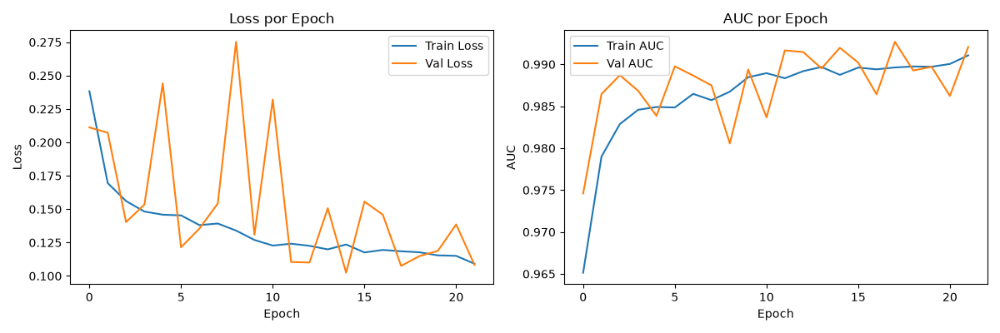

# Malaria Cell Detection — Deep Learning (Mestrado)

Classificação binária de células de malária (Parasitized vs Uninfected) usando o dataset NIH/Kaggle (27 558 imagens, 200 doentes).

---

## Problema e Dataset

| | |
|---|---|
| **Dataset** | [Malaria Cell Images — NIH](https://www.kaggle.com/datasets/iarunava/cell-images-for-detecting-malaria) |
| **Classes** | `Parasitized` (1) · `Uninfected` (0) |
| **Imagens** | 27 558 (nenhum duplicado exato encontrado por hash MD5) |
| **Doentes** | 200 IDs únicos extraídos do nome do ficheiro |
| **Tamanho de entrada** | 128×128 px, padding preto (sem distorção) |
| **Framework** | Keras 3 + backend PyTorch 2.11.0+cu128 |
| **GPU** | RTX 5060, CUDA 13.2 |

---

## Protocolo — Split por Doente

O split é feito **por doente** (não por imagem) para garantir independência entre conjuntos:

| Split | Doentes | Imagens |
|---|---|---|
| Treino | 140 (70 %) | ~19 380 |
| Validação | 30 (15 %) | 4 107 |
| Teste | 30 (15 %) | 4 071 |

**Porquê por doente?** Células do mesmo doente são altamente correlacionadas — fazer o split por imagem provocaria fuga de dados (*data leakage*) e AUC artificialmente elevada. O bootstrap de intervalos de confiança também é feito por reamostragem de doentes (não de imagens).

---

## Como Reproduzir

```bash
# 1. Criar venv e instalar dependências
python -m venv .venv
.venv\Scripts\activate
pip install -r requirements.txt

# 2. Colocar o dataset em data/raw/cell_images/ (estrutura Kaggle)
#    → data/raw/cell_images/Parasitized/*.png
#    → data/raw/cell_images/Uninfected/*.png

# 3. Correr o notebook do início ao fim (Restart & Run All)
#    notebooks/DL_P1_42.ipynb
#    O notebook trata do split, pré-processamento, treino e avaliação.
#    A célula de avaliação final invoca evaluate_all.py (incluído no repo).
```

> **Nota sobre o treino da CNN baseline (secção 16):** a célula de treino está intencionalmente comentada para que o *Restart & Run All* não demore vários minutos. O checkpoint final (`checkpoints/best_cnn.keras`) já está incluído/gerado no repositório. Para retreinar do zero, descomentar a célula manualmente antes de correr. **Atenção:** o `ModelCheckpoint` grava no mesmo caminho do checkpoint atual — descomentar e correr substitui o modelo existente.

**SEED** usada em todo o projecto: `42` para o treino da rede (Keras, NumPy, PyTorch, sklearn). O split por doente usou uma semente escolhida entre ~100 candidatas — a que melhor preservava a proporção de classes em cada partição.

> **Nota sobre determinismo:** mesmo com seed fixa, operações em GPU (cuDNN, CUDA atomics) introduzem não-determinismo residual entre máquinas ou versões de driver. Os resultados são reprodutíveis em tendência — as métricas devem convergir para a mesma gama de valores — mas pequenas diferenças na última casa decimal são esperadas e normais.

---

## Resultados de Validação (Oficial)

> Gerado com `best_cnn.keras` (checkpoint epoch 22, 25/09 12:22).
> IC 95 % por bootstrap com reamostragem por doente (n=1000).

| Modelo | Accuracy | F1 | ROC-AUC | PR-AUC |
|---|---|---|---|---|
| Aleatório | 0.504 (0.492–0.518) | 0.505 (0.382–0.561) | 0.501 (0.486–0.517) | 0.506 (0.308–0.632) |
| Maioria | 0.500 (0.374–0.707) | 0.000 (0.000–0.000) | 0.500 (0.500–0.500) | 0.500 (0.293–0.626) |
| Tamanho (HistGBM) | 0.532 (0.492–0.578) | 0.492 (0.374–0.554) | 0.544 (0.503–0.589) | 0.536 (0.324–0.659) |
| Clássico RGB (sem área) | 0.757 (0.676–0.815) | 0.772 (0.596–0.849) | 0.822 (0.728–0.882) | 0.803 (0.536–0.896) |
| **CNN (thresh=0.20)** | **0.969 (0.959–0.977)** | **0.969 (0.935–0.980)** | **0.993 (0.988–0.996)** | **0.994 (0.981–0.997)** |

---

## Resultados de Teste (Primeira e Única Avaliação)

> Threshold fixo em 0.20 (determinado no val, sem reajuste).

### Por seed (sem bootstrap)

| Seed | Accuracy | F1 | ROC-AUC | PR-AUC |
|---|---|---|---|---|
| 42 | 0.9531 | 0.9516 | 0.9854 | 0.9879 |
| 43 | 0.9484 | 0.9467 | 0.9815 | 0.9843 |
| 44 | 0.9519 | 0.9508 | 0.9866 | 0.9888 |
| **média ± dp** | **0.9511 ± 0.0024** | **0.9497 ± 0.0026** | **0.9845 ± 0.0027** | **0.9870 ± 0.0024** |

### Seed 42 — Bootstrap por doente no teste (n=1000) vs Baselines

| Modelo | Accuracy (IC 95%) | F1 (IC 95%) | ROC-AUC (IC 95%) | PR-AUC (IC 95%) |
|---|---|---|---|---|
| Aleatório | 0.504 (0.489–0.523) | 0.502 (0.359–0.561) | 0.501 (0.484–0.524) | 0.498 (0.273–0.642) |
| Maioria | 0.494 (0.262–0.641) | 0.661 (0.415–0.781) | 0.500 (0.500–0.500) | 0.494 (0.262–0.641) |
| Tamanho (HistGBM) | 0.536 (0.475–0.591) | 0.511 (0.359–0.624) | 0.542 (0.462–0.616) | 0.539 (0.292–0.703) |
| Clássico RGB | 0.691 (0.547–0.808) | 0.656 (0.421–0.818) | 0.758 (0.633–0.880) | 0.754 (0.520–0.885) |
| **CNN seed42 (thresh=0.20)** | **0.953 (0.941–0.968)** | **0.952 (0.919–0.963)** | **0.985 (0.976–0.991)** | **0.988 (0.967–0.993)** |


---

## Ablações

| Configuração | Params | Epochs | Tempo/epoch | Val AUC |
|---|---|---|---|---|
| Baseline (4 blocos + BN + Aug) | 389 633 | 24 | 69.3 s | **0.9930** |
| Sem Augmentation | 389 633 | 23 | 39.4 s | 0.9916 |
| Sem BatchNorm | 388 673 | 31 | 57.8 s | 0.9932 |
| 3 Blocos (sem Conv256) | 93 825 | 18 | 67.2 s | 0.9852 |

---

## Curvas de Treino



---

## Tempos de Treino

| Configuração | Epochs | Tempo/epoch | Total |
|---|---|---|---|
| Baseline seed 42 | 22 | ~69 s | ~25 min |
| Seed 43 | 33 | ~69 s | ~38 min |
| Seed 44 | 26 | ~69 s | ~30 min |

---

## Limitações

1. **Dataset de origem única:** todas as imagens são do mesmo laboratório (NIH), com a mesma técnica de coloração e aquisição. O modelo pode não generalizar para outras origens.
2. **Células já segmentadas:** o dataset fornece células individuais pré-extraídas, não imagens de esfregaço completo — o problema real de diagnóstico é mais difícil.
3. **Sem validação externa:** não existe conjunto de teste externo (outro laboratório, outro scanner). AUC 0.99 no teste interno é muito optimista e não deve ser extrapolado.
4. **Limiar fixo:** o limiar 0.20 foi escolhido no val por F1 — em contexto clínico o trade-off FN/FP seria determinado por especialistas, não por F1.

---

## Uso de IA

Ver [`AI_LOG.md`](AI_LOG.md) — registo completo de todos os pedidos e o que foi aceite.
